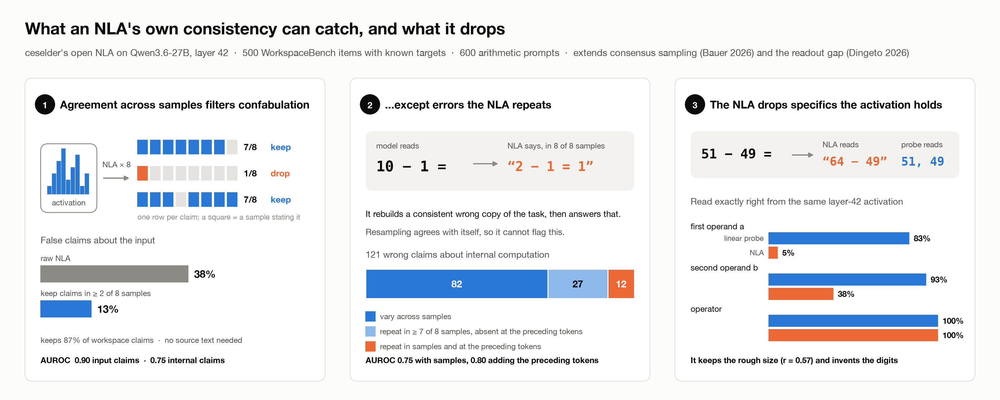
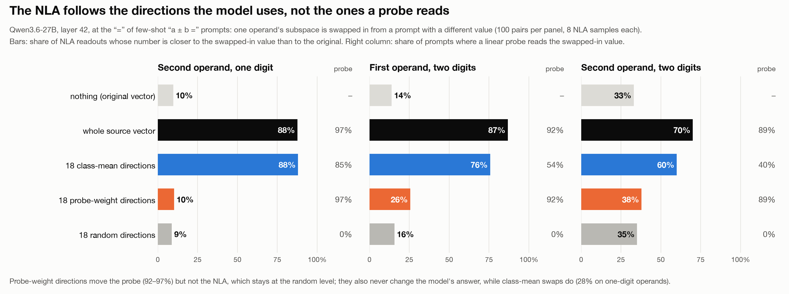

# NLA confabulation: a consistency filter, and what NLAs read

A mini project on [natural language autoencoders](https://transformer-circuits.pub/2026/nla/) (NLAs): which
parts of an NLA's explanation of an activation can you trust, using only the activation? Run on
[ceselder's open NLA](https://huggingface.co/ceselder/qwen3.6-27b-nla-rl) for Qwen3.6-27B (layer 42, RL step 400),
with [WorkspaceBench](https://www.lesswrong.com/posts/Zeg2JztbdhguL48uH/workspacebench-evaluating-interpretability-methods-for-the)
items as ground truth.



## Results

**1. Agreement filters confabulation.** Extending consensus sampling from activation oracles
([Bauer, 2026](https://arxiv.org/abs/2606.02609)) to NLA explanations: keep the claims that recur across 8 samples
of the same activation.

| Agreement signal | Input claims, AUROC true vs false | Internal claims, AUROC correct vs wrong |
| --- | --- | --- |
| 8 samples of the same activation | 0.90 | 0.75 |
| 3 preceding tokens (Anthropic's heuristic) | 0.74 | 0.69 |
| Both | 0.92 | 0.80 |

Keeping claims stated in at least 2 of 8 samples cuts false claims about the input from 38% to 13%, and keeps
87% of workspace claims, with no source text. For claims about internal computation, about a third of the wrong
ones repeat in at least 7 of 8 samples: the NLA rebuilds a consistent wrong copy of the task ("10 − 1 =" read as
"2 − 1 =", answer 1). The preceding-token check still separates right from wrong among those (AUROC 0.67). On
random vectors 29% of the NLA's claims are self-consistent, so consistency is evidence, not proof. Leaving
each family out in turn, the threshold rule re-selects ≥2 of 8 in four of five families and the held-out numbers
match (38% → 12%, 86% kept). A lens adds a second, independent check: for claims that name a specific word,
whether the [J++ Lens](https://www.lesswrong.com/posts/nc9dHfcB22JdMzGbr) ranks it in its top 50 at the same
vector lifts the AUROC from 0.77 to 0.81 (0.72 to 0.83 among claims the NLA repeats, only 28 of them wrong). A
removal test does not work, though: mean-ablating the J++ directions of the word a claim names (the word leaves the
lens's top 2,000) barely lowers the claim's support (correct 6.5 → 6.0 of 8, wrong 4.3 → 3.5) and does not separate
right from wrong claims (AUROC 0.49).

**2. The NLA reads what the model represents, causally but imprecisely, and whether or not the model uses it.** On 600 "a ± b =" prompts, a
linear probe reads both operands from the layer-42 activation exactly 83–93% of the time. The NLA, reading the same
vector (it never sees the prompt), always gets the operator right but the first operand only 5% of the time and the
second 38%; its numbers keep the rough size (r = 0.57 and 0.88). [Dingeto (2026)](https://arxiv.org/abs/2607.20379)
calls this a readout gap. To see which directions the NLA actually reads, we swapped one operand's subspace at "="
in from a prompt with a different value (300 few-shot pairs where Qwen answers, 8 NLA samples per condition):



The NLA follows 18 class-mean directions almost as well as the whole vector, and ignores the 18 directions the
probe relies on, which move the probe 89–97% of the time but leave the NLA at the random level. The model behaves
the same way where we can see it (one-digit operands: class-mean swaps change its answer 28% of the time,
probe-weight swaps never). So part of the probe's lead comes from directions neither the model at this position nor
the NLA uses; on the directions that matter, the NLA tracks the operand but imprecisely. A third reader agrees: the
J++ Lens, unlike the J-Lens and R-Lens, reads the one-digit operand, and it follows the class-mean swap (40%;
whole vector 51%) but not the probe-weight swap (2%) or random directions (1%).

The same holds for content the model computes. In 75 two-hop prompts ("the capital of the country where the Eiffel
Tower is located is"), swapping the bridge's lens direction for another's (France → Italy) at layers 20–40 changes
the model's answer in 81% of pairs, and every NLA sample then names the new bridge. But the NLA names it just as
reliably in the pairs where the model's answer does not change (14 of 14; over 90% of samples in a weaker pass where
65 of 75 answers stayed the same). An NLA claim about an intermediate says it is represented, not that it drives the
output; and adding a concept's direction steers the NLA, while removing it does not stop the NLA from naming it.

Why NLAs confabulate (a reconstruction reward that pays for pseudo-quotes and ignores false specifics) is covered by
[Anurin](https://www.lesswrong.com/posts/4nZwNPyfoadAxPH98/natural-language-autoencoders-are-summarizers-but-do-they),
[Zhang & TurnTrout](https://www.lesswrong.com/posts/LQXWiF8PyJ5ojNsEv/how-robust-are-natural-language-autoencoders-to),
[Hong](https://www.lesswrong.com/posts/DFgt8fi3Wzwwe2Sib/fixing-rewards-for-nla-to-reduce-confabulation) and
[Lek et al.](https://arxiv.org/abs/2609.33702).

## Contents

| Path | What |
| --- | --- |
| `notebook.ipynb` | Every number and figure above, recomputed from `data/` (CPU only, a few seconds) |
| `data/` | Claim labels, agreement counts, NLA samples, control vectors, arithmetic probes and readouts, steering test, lens readouts (described in the notebook) |
| `figures/` | The figures the notebook writes, plus the graphical abstract |
| `scripts/` | The pipeline that produced `data/` (GPU and API steps) |

Run the notebook:

```bash
uv run --no-project --with jupyter --with matplotlib jupyter lab notebook.ipynb
```

## Limitations

One open NLA, one layer and checkpoint; claim labels from one Gemini judge (every wrong internal claim checked by
hand); the preceding-token check also drops many correct claims; the operand test covers one format, computed intermediates three two-hop templates (75 pairs), and
"the model uses these directions" rests on one-digit operands (patching at "=" alone cannot change a two-digit answer). The
internal-claim AUROC rests on three families (multihop, basic readout, poetry); typo and association have one
wrong claim each.

## Reproducing `data/`

The scripts assume the [workspace-bench](https://github.com/camilablank/workspace-bench) package, the NLA weights,
a GPU with about 140 GB for the model and NLA together, and an OpenRouter key for the Gemini judges. The notebook's
last section maps each step to its script.
